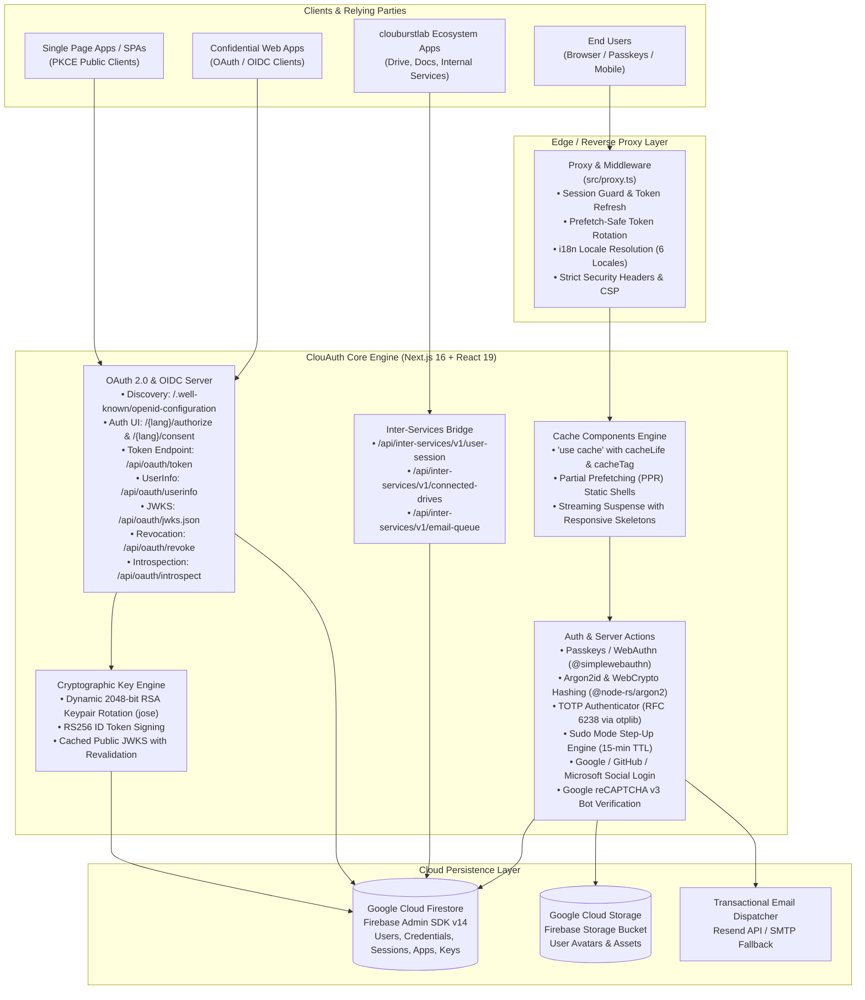
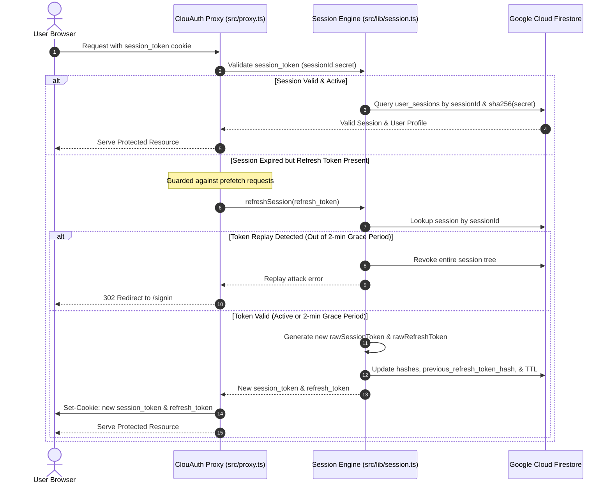

# 🏛️ ClouAuth Architecture & System Design

ClouAuth is a centralized, enterprise-grade **Authentication and OpenID Connect (OIDC 1.0) / OAuth 2.0 Identity Provider (IdP)** designed as the backbone authentication authority for the **clouburstlab** ecosystem and third-party developer applications.

---

## 📐 High-Level System Architecture

ClouAuth combines an edge-capable **Next.js 16 (React 19)** App Router architecture with **Cache Components**, **Partial Prefetching (PPR)**, **Google Cloud Firestore (Firebase Admin SDK v14)** persistence, **Google Cloud Storage (Firebase Storage)** for profile assets, and modular cryptographic microservices.

---

## 🔐 Authentication & Security Model

### 1. Multi-Factor Authentication (MFA / 2FA)
ClouAuth enforces a defense-in-depth model with multiple verification methods:
- **Passkeys (FIDO2 / WebAuthn):** Native passwordless and multi-factor biometric authentication implemented via `@simplewebauthn/server` and `@simplewebauthn/browser`. Includes authenticator signature counter tracking to detect authenticator cloning.
- **Time-Based One-Time Password (TOTP):** Fully compliant with RFC 6238 (Google Authenticator, Authy, 1Password) using Base32 shared secrets and clock drift tolerance.
- **SMS & Email OTP:** High-entropy verification codes hashed with SHA-256 before storage, accompanied by exponential lockout backoff to mitigate brute-force attempts.
- **Emergency Recovery Codes:** Single-use cryptographically random recovery codes hashed with Argon2id/SHA-256 in Firestore, enabling emergency account recovery if primary 2FA devices are lost.

### 2. Sudo Mode (Step-Up Authentication)
Privileged actions (such as generating recovery codes, updating passwords, modifying OAuth developer client secrets, and account deletion) require the user to enter **Sudo Mode**:
- A temporary, time-bounded challenge token (TTL: 15 minutes) is generated after re-verifying credentials or passkeys.
- The state is cryptographically bound to the current session and verified before executing privileged server actions (`src/actions/auth/sudo.actions.ts`).

### 3. Session Lifecycle & Token Rotation
ClouAuth utilizes an opaque, compound session token model rather than naive stateless JWTs for primary user sessions:

Key security mechanisms of the session architecture:
- **Compound Token Structure:** `sessionToken` = `${sessionId}.${randomHex}`. The database only stores `sha256(randomHex)`. Even full database read access does not leak usable session cookies.
- **Timing-Safe Comparison:** All token matching uses `crypto.timingSafeEqual` to eliminate timing side-channel attacks.
- **Refresh Token Rotation & Replay Detection:** Every token refresh revokes the existing refresh token and generates a new pair. If an older refresh token is presented outside a **2-minute grace period** (designed to absorb network retries and race conditions), the entire session family is immediately revoked as a suspected replay attack.
- **Prefetch Safety:** In `src/proxy.ts`, prefetch requests (`Purpose: prefetch`, `Sec-Purpose: prefetch`, `Next-Router-Prefetch`) are prevented from triggering token rotations to avoid consuming single-use refresh tokens prematurely.
- **Device & Geolocation Fingerprinting:** Sessions capture user-agent, operating system, browser, IP address, and a long-lived device identifier (`clou_device_id`) to alert users to unrecognized logins.

---

## ⚡ Cache Components & Partial Prefetching (PPR)

ClouAuth utilizes Next.js 16's Cache Components architecture:
- **`cacheComponents: true` & `partialPrefetching: true`:** Enables static App Shell prerendering combined with server-streaming dynamic Suspense boundaries.
- **Selective Caching Boundaries (`'use cache'`):**
  - `getDictionary`: Cached with `cacheLife("max")` and tagged by locale and namespace (`i18n:${locale}:${namespace}`).
  - `getProfileRecord`: Public profile lookups cached with `cacheLife("hours")` and tagged by username (`public-profile:${username}`).
  - `findOAuthClient`: Cached with `cacheLife("hours")` and tagged by client ID (`oauth-client:${clientId}`).
  - `getActivePublicJwks`: Signing keys cached with `cacheLife("hours")` and tagged (`sso-signing-keys`).
- **Atomic Cache Revalidation:** Mutations call `revalidateTag(tag, "default")` to invalidate only the affected profile or application data.
- **Zero-Layout-Shift Skeletons:** Each dynamic route is wrapped in a `<Suspense>` boundary backed by responsive skeletons matching the exact geometry of the server-rendered components.

---

## 🌐 OpenID Connect (OIDC) & OAuth 2.0 Server

ClouAuth functions as a certified-compliant Identity Provider exposing standard discovery and endpoint contracts:

### Discovery Document
Available at `/.well-known/openid-configuration`:
- **Issuer:** `https://auth.clouburstlab.com`
- **Supported Response Types:** `code`
- **Supported Grant Types:** `authorization_code`, `refresh_token`, `client_credentials`
- **Signing Algorithm:** `RS256`
- **PKCE Code Challenge:** `S256` (RFC 7636 mandatory for public clients)
- **Token Endpoint Auth Methods:** `client_secret_basic`, `client_secret_post`, `none`

### Asymmetric Key Management (RS256 JWKS)
- ClouAuth manages 2048-bit RSA key pairs dynamically generated via `jose`.
- Private keys sign OIDC ID tokens; public keys are exported as JSON Web Keys (JWK) and published at `/api/oauth/jwks.json`.
- Automatic key rotation is supported with zero client downtime by preserving active and valid historical keys in the `sso_signing_keys` collection in Firestore.

---

## 🗄️ Database Architecture (Google Cloud Firestore)

The data layer uses Google Cloud Firestore collections managed via the Firebase Admin SDK (`src/lib/firebase.ts`):

| Collection | Description | Key Documents & Fields |
| :--- | :--- | :--- |
| `users` | Primary user identity, profile, and settings | `username`, `first_name`, `last_name`, `bio`, `avatar`, `locale`, `visibility` |
| `user_credentials` | Security credentials and authentication data | `password_hash` (Argon2id), `totp_secret`, `backup_codes`, `passkeys` |
| `user_sessions` | Active sessions and refresh token rotation chains | `session_token_hash`, `refresh_token_hash`, `previous_refresh_token_hash`, `expires_at` |
| `temp_sessions` | Ephemeral verification and Sudo mode state | `user_id`, `type`, `token_hash`, `expires_at` (15-min TTL) |
| `user_apps` | Developer registered OAuth applications | `name`, `description`, `homepage_url`, `author_id`, `created_at` |
| `oauth_clients` | OAuth 2.0 client credentials and configuration | `client_id`, `client_secret_hash`, `redirect_uris`, `client_type` (confidential/public) |
| `oauth_client_ids` | Quick lookup index from `client_id` to `appId` | `appId` |
| `authorization_codes` | Short-lived OAuth authorization codes | `code_hash`, `client_id`, `code_challenge`, `user_id`, `expires_at` (10-min TTL) |
| `refresh_tokens` | OIDC / OAuth 2.0 access token refresh chains | `token_hash`, `client_id`, `user_id`, `scope`, `expires_at` |
| `security_activity` | Audit log of login events, password changes, MFA | `user_id`, `type`, `ip_address`, `user_agent`, `status`, `timestamp` |
| `sso_signing_keys` | Rotated RS256 private and public keypairs | `kid`, `public_jwk`, `private_pem`, `status` (active/retired), `created_at` |
| `connected_drives` | Third-party cloud storage access tokens | Google Drive, OneDrive, and Dropbox OAuth access and refresh tokens |

---

## 🔗 Inter-Services Bridge & Microservices

ClouAuth powers single sign-on across the entire **clouburstlab** portfolio:
- **`/api/inter-services/v1/user-session`:** Validates cross-subdomain sessions (`*.clouburstlab.com`) via cookies or machine-to-machine bearer tokens. Supports granular field scoping (`id`, `username`, `email`, `avatar`).
- **`/api/inter-services/v1/connected-drives`:** Securely stores and refreshes upstream OAuth tokens for third-party cloud drives (Google Drive, Microsoft OneDrive, Dropbox) on behalf of internal services.
- **`/api/inter-services/v1/email-queue`:** Decoupled asynchronous email delivery pipeline with exponential backoff and retry tracking via Resend.
